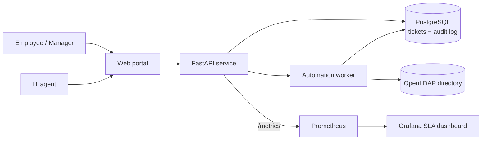

# HelpDesk Autopilot

A self-service IT help desk that automates the most common tickets (new-hire setup, offboarding and password resets) against a company directory, with manager approvals, a full audit trail and a live SLA dashboard.

> **Status:** in development. See the [roadmap](#roadmap).

## The problem

At small and mid-size companies, one or two IT people handle every request by hand:

- Password resets and new-hire setups eat most of the day.
- There is no clear record of who changed whose access, or when.
- Offboarding gets missed, so former employees keep working accounts.
- Nobody can say how long tickets take, or which ones break the SLA.

## The solution

HelpDesk Autopilot turns routine tickets into automated, approved and logged workflows.

| Ticket type | Today (manual) | With Autopilot |
|---|---|---|
| Password reset | IT verifies the user and resets by hand | One-time reset link, expires in 15 minutes |
| New hire | IT creates the account and adds groups from an email | Account and groups created from the request |
| Offboarding | Often delayed or forgotten | Account disabled and groups removed on the last day |
| Access request | Approved in chat, no record | Manager approval required, logged |

## Architecture

## Tech stack

| Area | Tools |
|---|---|
| App | Python, FastAPI, PostgreSQL |
| Directory | OpenLDAP (stands in for Active Directory / Entra ID) |
| Scripts | Python, PowerShell (bulk onboarding from CSV) |
| Testing | pytest, Playwright, 90% coverage gate |
| DevOps | Docker Compose, GitHub Actions, Trivy, CodeQL |
| Monitoring | Prometheus, Grafana |

## Roadmap

- [x] Requirements: BRD, user stories, process maps, SLA policy
- [ ] Ticket API with PostgreSQL and tests
- [ ] Directory automation: onboarding, offboarding, password reset
- [ ] Manager approvals and audit log
- [ ] Web portal with Playwright tests
- [ ] CI pipeline with security scans
- [ ] Prometheus metrics and Grafana SLA dashboard
- [ ] Demo data, screenshots and walkthrough

## Documentation

- [Business Requirements Document](docs/BRD.md)
- [User stories and acceptance criteria](docs/user-stories.md)
- [As-is and to-be process maps](docs/process-map.md)
- [SLA policy](docs/sla-policy.md)

## License

MIT
