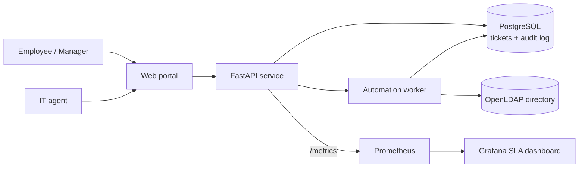

# HelpDesk Autopilot

A self-service IT help desk that automates the most common tickets (new-hire setup, offboarding and password resets) against a company directory, with manager approvals, a full audit trail and a live SLA dashboard.

> **Status:** in development. See the [roadmap](#roadmap).

## The problem

At small and mid-size companies, one or two IT people handle every request by hand:

- Password resets and new-hire setups eat most of the day.
- There is no clear record of who changed whose access, or when.
- Offboarding gets missed, so former employees keep working accounts.
- Nobody can say how long tickets take, or which ones break the SLA.

## The solution

HelpDesk Autopilot turns routine tickets into automated, approved and logged workflows.

| Ticket type | Today (manual) | With Autopilot |
|---|---|---|
| Password reset | IT verifies the user and resets by hand | One-time reset link, expires in 15 minutes |
| New hire | IT creates the account and adds groups from an email | Account and groups created from the request |
| Offboarding | Often delayed or forgotten | Account disabled and groups removed on the last day |
| Access request | Approved in chat, no record | Manager approval required, logged |

## Architecture



## Tech stack

| Area | Tools |
|---|---|
| App | Python, FastAPI, PostgreSQL |
| Directory | OpenLDAP (stands in for Active Directory / Entra ID) |
| Scripts | Python, PowerShell (bulk onboarding from CSV) |
| Testing | pytest, Playwright, 90% coverage gate |
| DevOps | Docker Compose, GitHub Actions, Trivy, CodeQL |
| Monitoring | Prometheus, Grafana |

## Roadmap

- [x] Requirements: BRD, user stories, process maps, SLA policy
- [x] Ticket API with PostgreSQL and tests
- [x] Directory automation: onboarding, offboarding, password reset
- [ ] Manager approvals and audit log
- [ ] Web portal with Playwright tests
- [ ] CI pipeline with security scans
- [ ] Prometheus metrics and Grafana SLA dashboard
- [ ] Demo data, screenshots and walkthrough

## Run it locally

You need Docker Desktop. Run these from the project folder:

```bash
cp .env.example .env
docker compose up --build -d
docker compose exec api python -m app.seed
```

The last command gives each demo user a directory account and prints their API token:

| User | Role | Department |
|---|---|---|
| emma | Employee | Finance |
| noah | Employee | Engineering |
| liam | Manager | Finance |
| ava | IT agent | IT |

Open http://127.0.0.1:8000/docs to try the API in your browser. Click **Authorize** and paste a token.

Or use curl:

```bash
curl -X POST http://127.0.0.1:8000/api/tickets \
  -H "Authorization: Bearer <emma's token>" \
  -H "Content-Type: application/json" \
  -d '{"type":"password_reset","title":"Locked out of email","description":"MFA keeps failing"}'
```

## What the automations do

| Ticket type | Who can file it | What happens |
|---|---|---|
| `password_reset` | Anyone | A one-time link (15 minutes, works once) goes to your inbox. Ticket auto-resolves |
| `new_hire` | Manager or IT | Directory account created with the department's groups. The manager gets the username and a 72-hour set-password link |
| `offboarding` | Manager or IT | After the last day ends: all groups removed, password removed, account moved to `ou=Disabled` |
| `access_request`, `hardware` | Anyone | Goes to the IT queue (approvals come in the next step) |

Every directory change is written to the audit log. If an automation fails, completed steps are undone, the ticket moves to `in_progress` with the error, and IT picks it up.

**Example: new hire** (as Liam)

```json
{
  "type": "new_hire",
  "title": "New financial analyst",
  "description": "Starts next Monday",
  "details": {"first_name": "Jane", "last_name": "Doe", "department": "Finance", "start_date": "2026-10-26"}
}
```

Departments: Engineering, Finance, IT, Operations, Sales.

**Example: offboarding** (as Liam)

```json
{
  "type": "offboarding",
  "title": "Noah's last day",
  "description": "Moving to another company",
  "details": {"username": "noah", "last_day": "2026-10-19"}
}
```

A past last day runs right away. A future one waits for the worker, which checks every minute.

## Security choices

- The app signs in to the directory with a service account that can only manage `ou=Users`, `ou=Groups` and `ou=Disabled`. It cannot change anything else.
- Passwords are set with the LDAP password modify operation, so the directory hashes them with Argon2id. The app never stores passwords.
- API tokens and password links are random 256-bit values, stored only as SHA-256 hashes.
- Password links give one generic error for wrong, used or expired links, so they can't be probed.
- LDAP search filters and names are escaped against injection.

## API

| Method | Path | Who | What |
|---|---|---|---|
| GET | `/health` | Anyone | Health check |
| POST | `/api/tickets` | Signed in | Create a ticket. Automations run right away |
| GET | `/api/tickets` | Signed in | Employees see their own tickets, IT agents see all. Filter with `status`, `type`, `priority` |
| GET | `/api/tickets/{id}` | Owner or agent | One ticket. Other people's tickets return 404 |
| PATCH | `/api/tickets/{id}/status` | Agent | Change status. Resolving records the time |
| GET | `/api/inbox` | Signed in | Your messages (stands in for email in the demo) |
| POST | `/api/password-resets/{token}` | Link holder | Set a new password (12+ characters, not containing your username) |
| POST | `/api/automation/run-due` | Agent | Run due offboardings now instead of waiting for the worker |

## Run the tests

```bash
python3 -m venv .venv
source .venv/bin/activate
pip install -r requirements-dev.txt
python -m pytest
```

Tests use in-memory SQLite and an in-memory directory by default, plus an ldap3 mock LDAP server. Coverage below 90% fails the run.

To also run the directory tests against the real OpenLDAP container, set `LDAP_TEST_URL` and `LDAP_TEST_BIND_PASSWORD`.

## Documentation

- [Business Requirements Document](docs/BRD.md)
- [User stories and acceptance criteria](docs/user-stories.md)
- [As-is and to-be process maps](docs/process-map.md)
- [SLA policy](docs/sla-policy.md)

## License

MIT
