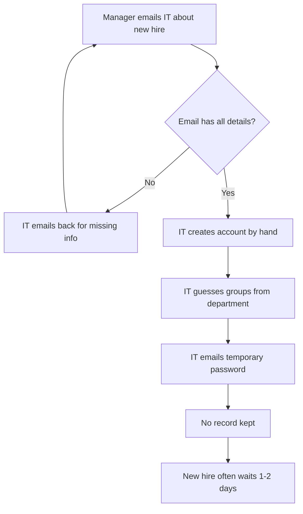
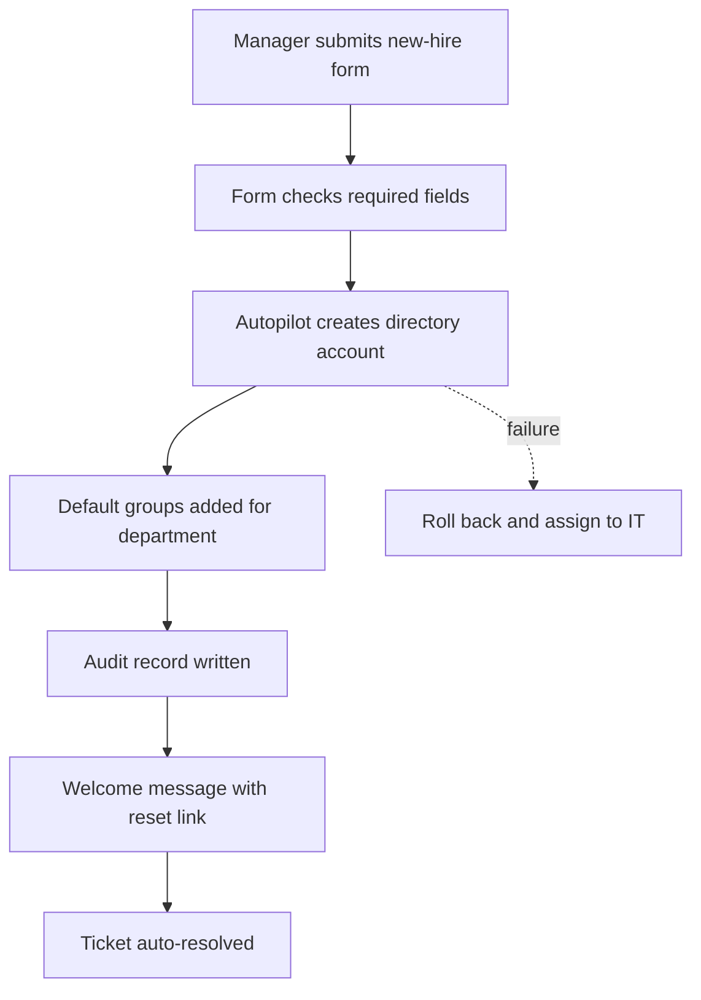
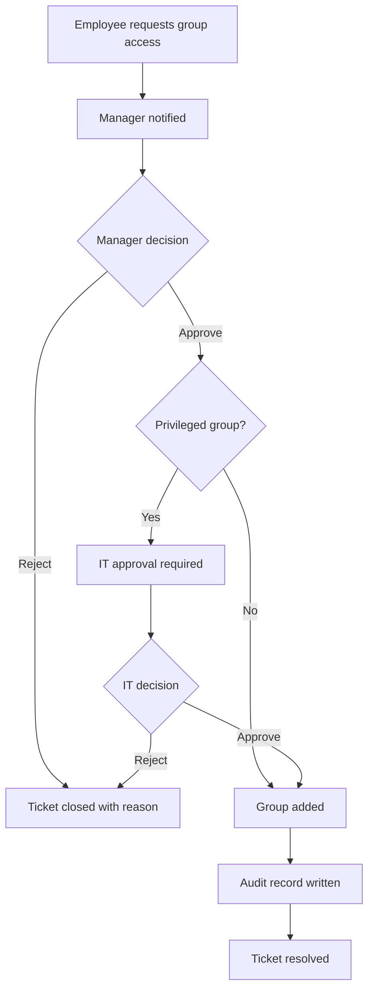

# Process Maps

GitHub renders these diagrams automatically.

## New hire: as-is (manual)

**Pain points:** back-and-forth emails, wrong or missing groups, passwords sent in email, no audit trail. Average time: 2 days.

## New hire: to-be (Autopilot)

**Result:** no back-and-forth, consistent groups, no passwords in email, every step logged. Target: under 10 minutes.

## Access request: to-be

## Offboarding: as-is vs to-be

| Step | As-is | To-be |
|---|---|---|
| Trigger | HR remembers to email IT | Manager or HR files offboarding ticket with last day |
| Timing | Days or weeks late | Runs automatically at end of last day |
| Account | Sometimes left active | Disabled |
| Groups | Often left in place | All removed and listed in audit log |
| Evidence | None | Audit record per change |
